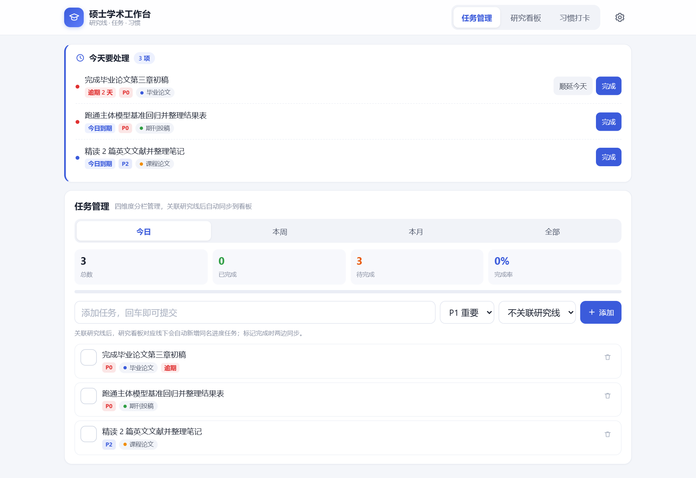
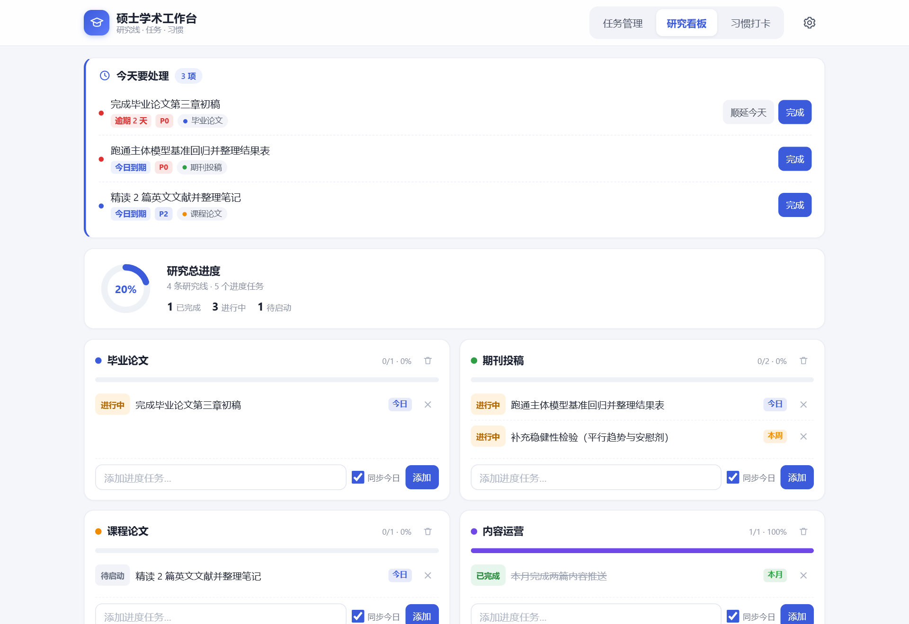
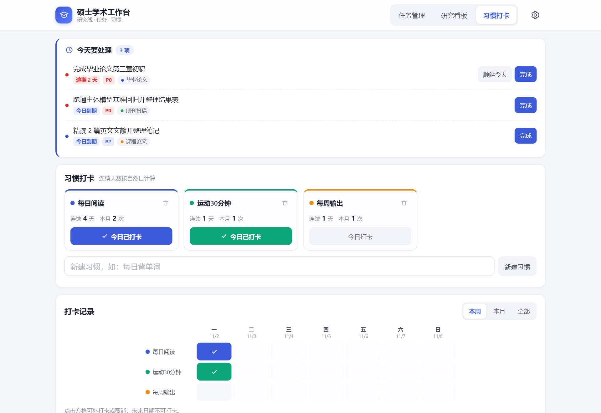
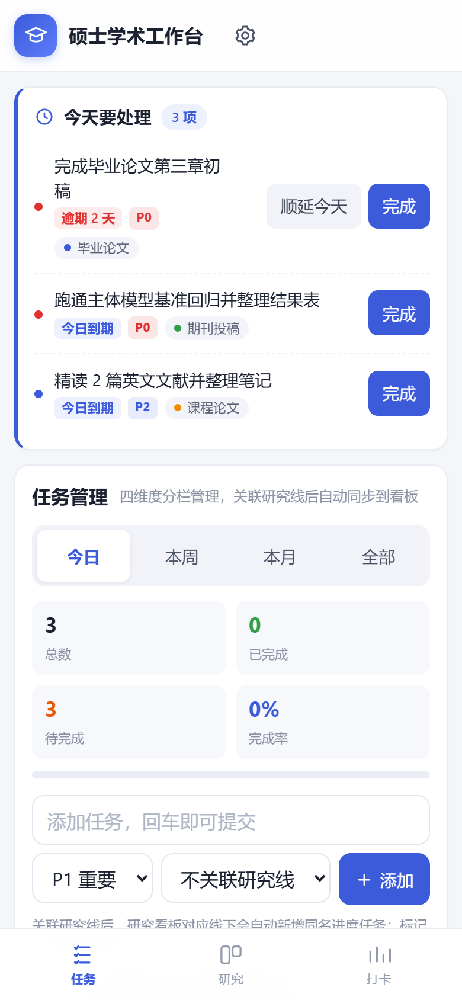

# 学术工作台 · Academic Workspace

> [Prompt Lab](../README.md) / academic-workspace

> 一个**单文件、零依赖、打开即用**的学术研究管理工作台。
> 任务管理、研究进度看板、习惯打卡三块联动；数据只存在你自己的浏览器里。
> 提示词与生成过程完整公开，见 [docs/prompt.md](docs/prompt.md)。
>
> 在线试用：<https://amkles.github.io/prompt-lab/academic-workspace/>



---

## 为什么是单文件

大多数「效率工具」需要注册、联网、装客户端。这个项目反过来：

- **一个 HTML 文件就是全部**：CSS、JS、图标、图表全部内联，没有任何外部请求
- **断网可用**：飞机上、图书馆没网，双击就打开
- **数据不上云**：全部存在浏览器 `localStorage`，没有账号、没有服务器、没有埋点
- **改起来没有门槛**：没有构建、没有依赖、没有 `npm install`，用记事本就能改

代价是它不会自动跨设备同步——这一点在「已知限制」里写清楚了，解决办法是导出/导入 JSON。

---

## 功能

### 1. 任务管理（四维度）

子 Tab 切换 **今日 / 本周 / 本月 / 全部**，每个维度有独立列表和统计（总数、已完成、待完成、完成率 + 进度条）。

任务字段：内容、优先级（P0 红 / P1 黄 / P2 蓝）、可关联研究线。

### 2. 研究进度看板

顶部是总进度环，下面每条研究线一张卡片：专属颜色、完成进度条、进度任务列表。

进度任务状态点击循环切换：**待启动 → 进行中 → 已完成**。支持添加、删除进度任务，支持删除整条研究线（二次确认）。



### 3. 习惯打卡

每张习惯卡片可「今日打卡」（再点取消），显示连续天数与本月次数。

打卡记录三档视图：

- **本周**：7 天横排网格，可点格补打卡
- **本月**：月历网格，格中小圆点表示各习惯当天情况
- **全部**：近 12 个月的 SVG 柱状图 + 各习惯累计次数



---

## 六条联动规则（核心）

这三块双向绑定，是本项目真正的重点。

| # | 你做的操作 | 系统自动做的事 |
|---|---|---|
| 1 | 看板添加进度任务（「同步今日」默认勾选） | 今日待办生成同名任务，两边绑定 |
| 2 | 任务管理添加任务时关联某条研究线 | 对应研究线下自动新增同名进度任务 |
| 3 | 在「全部」维度添加任务 | 自动新建一条同名研究线，该任务成为它的第一个进度任务 |
| 4 | 任意一边标记完成 | 另一边状态同步；从「已完成」退回也会同步取消 |
| 5 | 删除本月 / 总任务 | 连带删除看板对应的进度任务 |
| 5b | 删除今日 / 本周任务 | 只解除关联，看板的进度任务保留 |
| 6 | 进度任务有来源维度 | 显示彩色标签：今日蓝 / 本周黄 / 本月绿 / 总任务紫 |

绑定关系靠 `task.progId` 与 `prog.taskId` 互相指向，详见 [docs/data-model.md](docs/data-model.md)。

---

## 快速开始

```bash
git clone https://github.com/Amkles/prompt-lab.git
cd prompt-lab/academic-workspace
```

然后**双击 `index.html`** 即可，不需要任何构建步骤。

想用本地服务器打开（避免个别浏览器对 `file://` 的限制）：

```bash
python -m http.server 8000
# 浏览器访问 http://localhost:8000
```

**手机使用**：直接访问 <https://amkles.github.io/prompt-lab/academic-workspace/>，或把 `index.html` 发到手机用浏览器打开，再「添加到主屏幕」，就是一个全屏 App 的观感。



---

## 用 AI 生成同款

这个项目由 WorkBuddy 的「工作台搭建师」专家生成，再经人工验收打磨。提示词、生成流程、验收方法全部公开在 **[docs/prompt.md](docs/prompt.md)**：

- **完整提示词**：可直接复制，改几处占位符就是你自己的场景
- **每条要求在防什么**：为什么「禁止 CDN」「禁止 emoji 当图标」属于硬性约束
- **生成过程**：为什么分次写入、用什么跑断言、四档视口怎么测
- **18 条验收清单**：拿到任何一份 AI 生成的工作台，都可以照它过一遍

想改成别的场景（内容创作台、考公台、育儿台），看文档第 5 节的变量替换表，改四五处即可复用整套联动骨架。

另外两份文档面向想改代码的人：[docs/data-model.md](docs/data-model.md) 是数据字段与六条联动规则的实现说明。

---

## 数据与隐私

- 存储位置：浏览器 `localStorage`，键名 `wb_academic_master_v1`
- 页面**不发起任何网络请求**，没有账号体系，没有统计脚本
- 换设备 / 换浏览器 / 清理缓存前，请在右上角**设置 → 导出 JSON 备份**
- 部署成公开网页后：每个访问者的数据互相隔离，各存各的浏览器，你看不到别人的，别人也看不到你的
- 「清空全部数据」有二次确认弹窗

---

## 数据结构

```js
{
  tasks: [
    { id, text, pri: 'P0'|'P1'|'P2', scope: 'today'|'week'|'month'|'all',
      date: 'YYYY-MM-DD'|null, lineId, progId, done, createdAt }
  ],
  lines: [
    { id, name, color,
      tasks: [ { id, text, status: 0|1|2, scope, taskId } ] }
  ],
  habits: [
    { id, name, color, log: { 'YYYY-MM-DD': true } }
  ]
}
```

`status`：`0` 待启动 / `1` 进行中 / `2` 已完成。`PRI` 与 `SCOPE` 是配色表，改名改色在文件顶部改。

---

## 技术说明

| 项 | 说明 |
|---|---|
| 体积 | 单文件约 67 KB，1500 行 |
| 依赖 | 无。无框架、无 CDN、无字体文件、无图表库 |
| 图表 | 进度环、柱状图、月历全部手写内联 SVG |
| 图标 | 内联 SVG path，不使用 emoji 充当图标 |
| 字体 | 系统字体栈 `-apple-system, BlinkMacSystemFont, "Segoe UI", Roboto...` |
| 响应式 | ≥768px 顶部导航；<768px 底部 Tab + 单列堆叠 |
| 可访问性 | 按钮点击区 ≥44px，输入框字号 16px（避免 iOS 自动放大），适配 `env(safe-area-inset-bottom)` |

**改配色**：文件顶部 `:root` 里改 `--pri`，其余颜色变量跟随。
**改维度**：`SCOPE` 常量 + 「任务管理」的四颗 Tab 按钮，两处一起改。

代码结构分三层，单向调用：

```
数据层（localStorage 读写）
   ↓
业务联动层（增删改 + 双向同步）
   ↓
渲染层（renderToday / renderTasks / renderBoard / renderHabits）
   ↑
refreshAll() 统一调度，渲染函数之间互不调用
```

`refreshAll()` 是唯一的刷新入口，任何交互都是「改数据 → `commit()` → 重新渲染」，从架构上杜绝了渲染函数互相触发导致的递归。

---

## 已知限制

- **不跨设备同步**：这是「零服务端」的必然代价，用导出/导入 JSON 迁移
- 清除浏览器数据 = 数据丢失，请定期导出备份
- 不支持附件与图片
- 没有系统通知与提醒，靠页面顶部「今天要处理」置顶区
- `localStorage` 一般上限约 5 MB，纯文本数据够用很多年

---

## Roadmap

- [ ] 周报自动汇总：按本周完成项生成可复制的文本
- [ ] 论文/章节甘特视图
- [ ] 番茄钟与专注时长记录
- [ ] 可选云端同步（接 Supabase，默认关闭）

---

## English

A single-file, zero-dependency academic workspace for grad students: task management across four scopes (today / week / month / all), a research progress board with bidirectional task syncing, and habit tracking with week/month/year views. Everything is inlined in one `index.html` — no build, no CDN, no tracking. Data lives in your browser's `localStorage` and never leaves the device. MIT licensed.

---

## License

[MIT](../LICENSE) © 2026 Amkles
