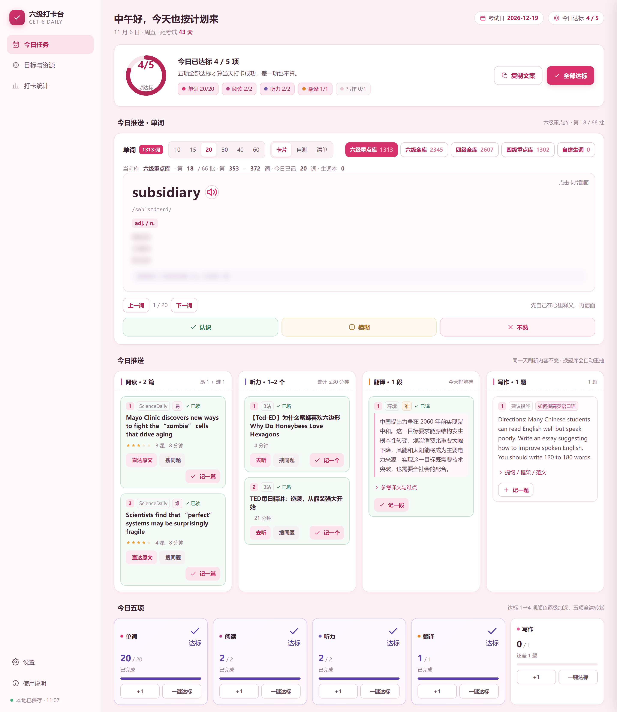
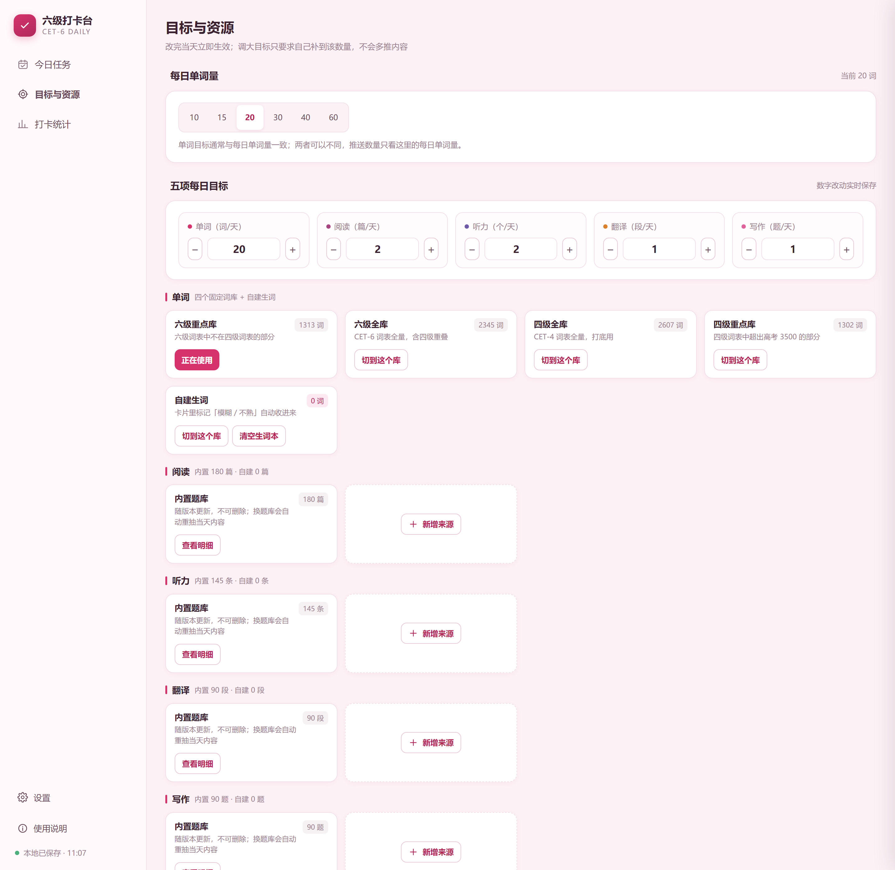
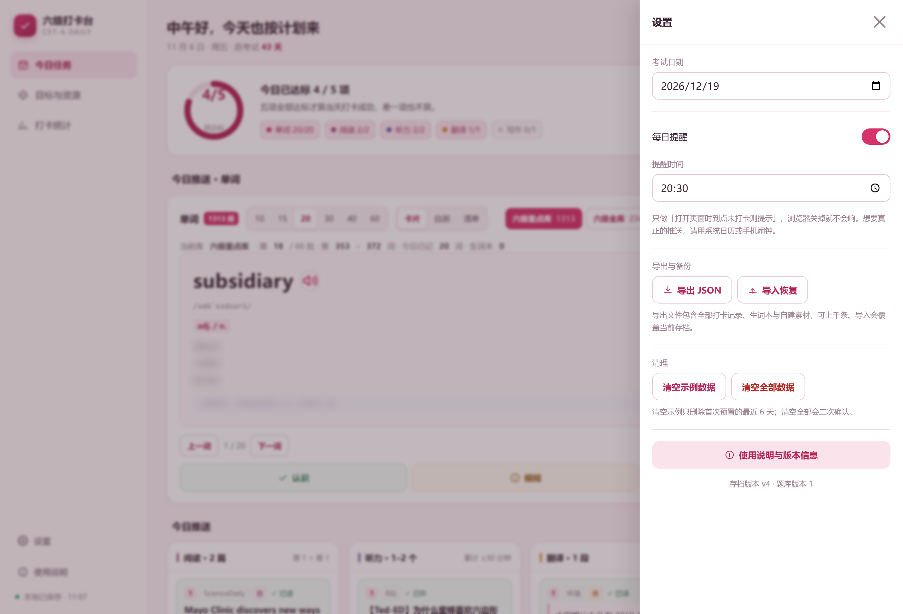
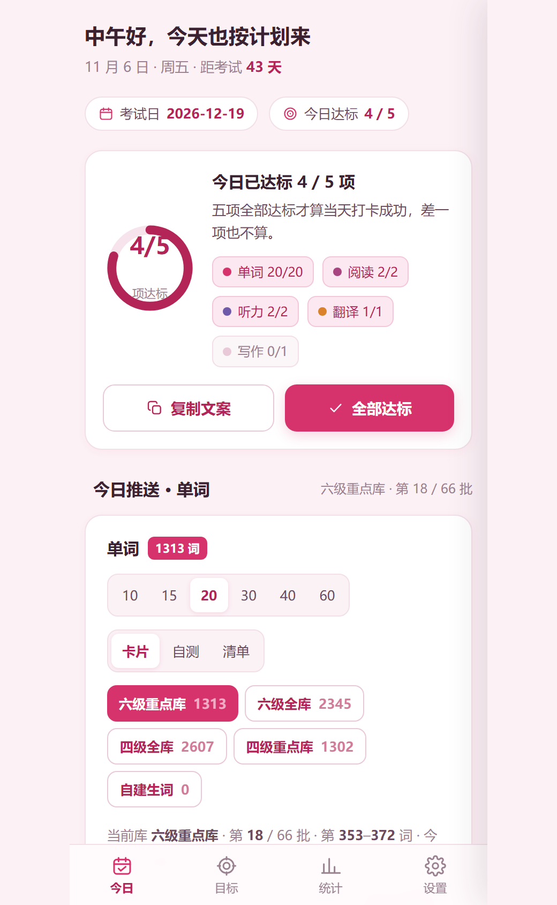
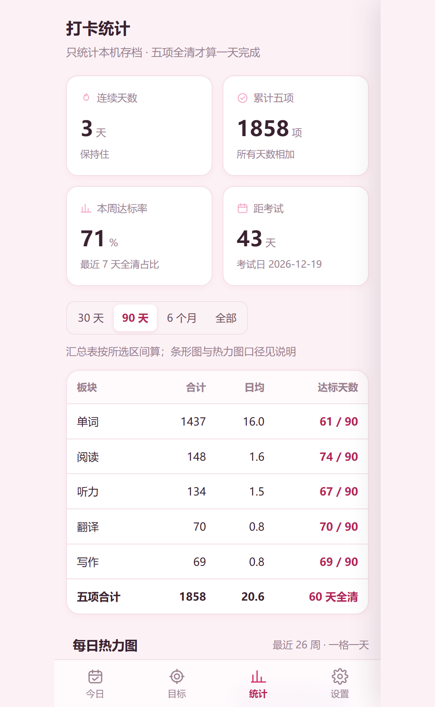
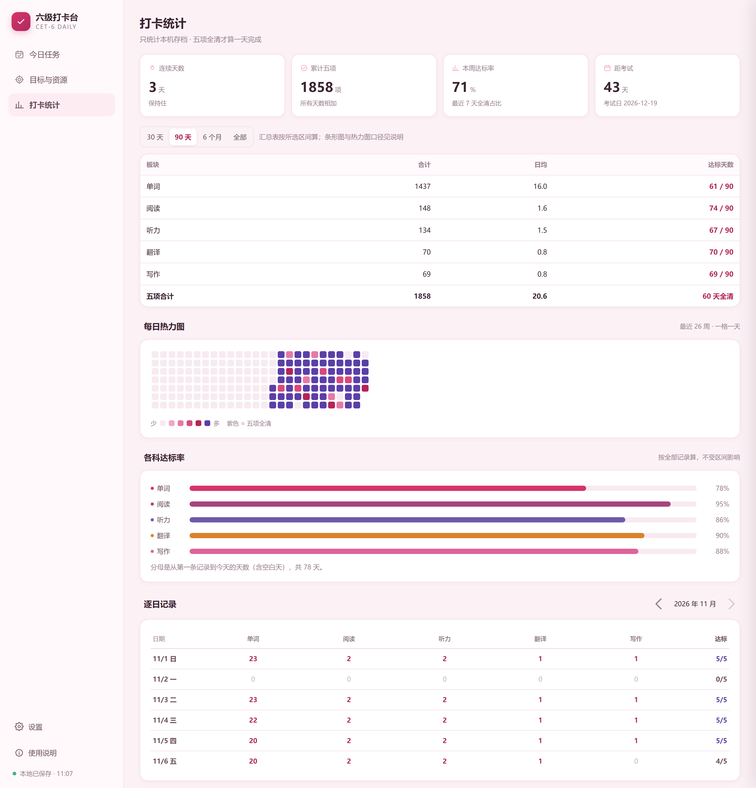

# 六级打卡台 · CET-6 Daily

> [Prompt Lab](../..) / projects / cet6-daily

> 一个**单文件、零依赖、打开即用**的六级备考打卡台。
> 每天自动抽出「今天该背哪些词、读哪两篇、听哪几段、翻哪一段、写哪一题」，
> 做完点一下就计数，五项全清算这天打卡成功。数据只存在你自己的浏览器里。



提示词与算法细节全部公开：[docs/prompt.md](docs/prompt.md) · [docs/algorithm.md](docs/algorithm.md)

> 想直接用：直接下载 `index.html` 双击打开即可，不需要任何环境。
> 本仓库的 Pages 由 GitHub Actions 自动发布（`.github/workflows/pages.yml`），推送到 `main` 后一分钟内生效。

---

## 为什么是单文件

备考工具最容易死在「配置」上：装客户端、注册账号、开会员、同步失败。这个项目把这些环节全部砍掉。

- **一个 `index.html` 就是全部**：CSS、JS、图标、图表、题库全内联，运行时不发任何外部请求
- **断网可用**：图书馆、自习室、飞机上，双击就开
- **数据不上云**：全部在 `localStorage`，没有账号、没有服务器、没有埋点
- **改起来没有门槛**：运行时没有构建、没有依赖，记事本改一行刷新就生效（只有跑测试才需要装一个 jsdom）

代价是它不会自动跨设备同步。这一点写在[已知限制](#已知限制)里，解决办法是导出/导入 JSON。

---

## 功能

### 1. 今日任务

顶栏给问候语、日期、距考试天数；下面一条**逾期条**说明昨天差了多少、已经并进今天（也可以一键「只做今天」）。

进度卡用环形图表示 `N/5`，五个板块各一个状态点；五项全清后整张卡换成紫色徽标态。

**今日推送**分四列，每列都是当天抽出来的真题素材：

| 列 | 每天给多少 | 卡片上有什么 |
|---|---|---|
| 阅读 | 2 篇（易 1 + 难 1） | 序号、标题、来源平台、1–5 星、预计时长、`直达原文`（打不开时用 `搜同题`） |
| 听力 | 1–2 个，累计 ≤ 30 分钟 | 标题、平台、分钟数、`去听` / `搜同题` |
| 翻译 | 1 段（单双日交替易/难） | 中文题干，展开看参考译文与 2–3 条难点提示 |
| 写作 | 1 题（六类轮转） | Directions、三点提纲、三段框架、100–160 词范文、可替换词组 |

每条右侧有 `记一篇 / 记一个 / 记一段`，点一下就把该板块的当日计数 +1，不用再回去改数字。

最下面是**五项卡**：目标、已完成、还差多少，配 `+1` 和 `一键达标`。

### 2. 单词

四个固定词库加一个自建生词本，切库只换推进名单，记忆状态和生词本跨库保留：

| 词库 | 词数 | 说明 |
|---|---|---|
| 四级全库 | 2607 | 四级词表全部 |
| 四级重点 | 1302 | 四级词表超出高考 3500 的部分 |
| 六级全库 | 2345 | 六级词表全部，含四级重叠 |
| 六级重点 | 1313 | 六级词表里四级没有的部分 |

每天 10 / 15 / 20 / 30 / 40 / 60 词可选，按日期顺序往后推，翻完回开头。
三种模式：

- **卡片**：先遮释义，点卡翻面，按「认识 / 模糊 / 不熟」自评；模糊与不熟进生词本，隔天优先
- **自测**：四选一，答错自动进生词本
- **清单**：当批词一览，带记忆状态点

词卡显示词、音标、词性、释义、词缀提示（后缀必须与词性匹配才给，宁缺勿错），发音用浏览器语音合成。
词性缺失时整块不渲染，不留空占位——四级词书里约六成词条没有标注词性。

### 3. 目标与资源

每日单词量、五项每日目标都能改，改完当天立即生效；目标调大不会多推内容，只要求你补到数。

素材按五个板块分组，每组是「内置题库 + 自建来源」：

- 内置题库随版本更新，不可删除，换题库会自动重抽当天内容
- 自建来源可以新增、绑定素材、改名、删单条、清空
- 绑定素材时能选这批算哪一档（阅读选易/难，听力填分钟数）

页面底部给三个真实外链：双语新闻、作文批改、CEFR 写作练习。



### 4. 打卡统计

四张数据卡（连续天数、累计五项、本周达标率、距考试天数），区间可选 30 天 / 90 天 / 6 个月 / 全部。

- **汇总表**：五个板块的合计、日均、达标天数，按所选区间统计
- **热力图**：一格一天，颜色随达标项数加深，五项全清是紫色，最多 26 周一屏看全
- **各科达标率**：内联 SVG 横向条形图，按全部记录算，不受区间影响
- **逐日记录**：按月翻，最多回看 6 个月

首次打开会预置最近 6 天示例（含完成与未完成），在设置里可以一键清掉。

### 5. 设置与说明

考试日期、每日提醒开关与时间、导出 JSON、导入恢复（支持上千条）、清空示例、清空全部（二次确认）。
「使用说明」是独立一页，九个小节把用法、抽取规则、统计口径、数据备份、提醒边界全写清楚。



### 6. 手机端

≤768px 换成底部四个 Tab，卡片单列堆叠，热力图与条形图跟着缩，不出现横向滚动。

<p align="center">
  
  
</p>

---

## 推送是怎么抽的

这是整个项目最容易做歪的部分，写在这里省得你去读代码。

**冷却天数不是写死的，而是按池长反推。** 阅读两档各自独立，冷却 = 该档池长；听力 1–2 条/天，冷却 = `max(6, 池长 × 0.66)`；翻译单双日交替，冷却 = 当日档位池长 × 2；写作冷却 = 池长。每条素材记「上次出现在第几天」，`今天 − 上次 ≥ 冷却` 才进候选。

**候选不够时按「最久没出现」补位，绝不空手。** 池子里任何一条都不满足冷却，就把整个池按上次出现时间升序排，从头拿。

**同一天刷新内容不变。** 用「当日种子 + 板块名」打乱，种子由日期、池版本号和池签名组成；抽出来的结果连同签名一起存进存档，刷新只是读回来。

**题库换过要升池版本号。** 签名不符就作废重抽，并把新结果记进「已出现」记录。删掉旧题库不升版本号，是这类应用最常见的脏数据来源。



完整规则（含听力凑时长、自建素材置顶、记录上限）见 [docs/algorithm.md](docs/algorithm.md)。

---

## 素材导入

「绑定素材」的输入框能吃下八种形态，直接粘分享文案就行：

```
标题 | 链接
标题一行，链接下一行
https://example.com/a
example.com/a                     ← 无协议会自动补 https://
b23.tv/abc123                     ← 短链同样处理
[{"title":"…","url":"…"}]         ← JSON 数组，也支持 {items|list|data|result:[…]} 包裹
<item><title>…</title><link>…</link></item>   ← RSS / Atom
# 注释行会被跳过
```

标题会按固定顺序清洗：剥分享尾巴 → 剥行首短码 → 剥作者前缀与引导语 → 剥 emoji 与 `#话题#` → 剥外层括号 → 剥来源后缀（`- 哔哩哔哩`、`_bilibili`、`- 小红书`、`- 抖音`、`- YouTube`）→ 剥残留分隔符。
URL 截取**排除中文标点**，否则「看这个 https://a.com/x，很有用」会把逗号吃进链接里。

平台识别覆盖 B 站（含 `b23.tv`）、小红书（含 `xhslink`）、抖音（含 `iesdouyin`）、YouTube、TED，其余显示域名。

---

## 数据结构

全部存在 `localStorage['wb_cet6_data']`，带 schema 版本号，旧存档自动迁移且不清空：

```jsonc
{
  "v": 4,                       // schema 版本
  "poolV": 1,                   // 题库版本，换题库时 +1
  "examDate": "2026-12-19",
  "word": { "perDay": 20, "lib": "c6key", "mode": "card" },
  "goals": { "word": 20, "read": 2, "listen": 2, "trans": 1, "write": 1 },
  "days": { "2026-11-06": { "w": 20, "r": 2, "l": 2, "t": 1, "p": 0, "carry": true } },
  "push": { "2026-11-06": { "re": ["…"], "rh": ["…"], "l": ["…"], "t": ["…"], "w": ["…"],
                            "sig": { "re": "90#…", "rh": "90#…", "l": "145#…" }, "poolV": 1 } },
  "marks": { "word": {} },      // 单词记忆状态
  "news": [],                   // 生词本
  "sources": [],                // 自建来源 [{ id, name, note, kind, items:[{ id, title, url, level, min }] }],
  "seen": { "read": {}, "listen": {}, "trans": {}, "write": {} },
  "seenOrder": { "read": [], "listen": [], "trans": [], "write": [] },
  "settings": { "remind": true, "at": "20:30", "sample": true }
}
```

字段级说明见 [docs/data-model.md](docs/data-model.md)。

---

## 目录结构

```
cet6-daily/
├── index.html              # 构建产物：单文件应用（684 KB，可直接分发）
├── src/
│   ├── index.template.html # 页面骨架，含 /*__CSS__*/ /*__DATA__*/ /*__APP__*/ 占位
│   ├── style.css           # 全部样式
│   ├── core.js             # 数据层：存档、抽取、统计、解析、词库
│   ├── views.js            # 视图层：五个页面 + 弹窗，纯字符串拼 HTML
│   └── boot.js             # 交互层：单一事件委托 + 全部 data-act
├── data/
│   ├── vocab.json          # 3920 词条 + 四个词库的窗口定义
│   ├── reading.json        # 阅读 180（易 90 / 难 90）
│   ├── listening.json      # 听力 145（B 站真实视频页，带分钟数）
│   ├── translation_*.json  # 翻译 90（易 45 / 难 45）
│   └── writing_*.json      # 写作 90（六类各 15）
├── tools/
│   ├── build.py            # 把 src + data 打成 index.html，并校验题库规模
│   ├── build_vocab.py      # 从开源词书生成 vocab.json
│   ├── harvest_reading.py  # 抓 RSS/Atom 生成 reading.json
│   ├── harvest_listening.py # 抓 B 站搜索页生成 listening.json
│   ├── shots.py            # 无头浏览器出截图
│   └── probe.py            # 布局溢出诊断
├── tests/
│   ├── parse.test.js       # 素材解析 13 条用例
│   ├── draw.test.js        # 400 天抽取压力测试
│   └── smoke.test.js       # 页面渲染 + 交互冒烟
└── docs/
    ├── prompt.md           # 生成这个项目的完整提示词
    ├── algorithm.md        # 抽取算法与边界
    ├── data-model.md       # 存档结构
    └── screenshots/
```

---

## 构建与测试

运行时不需要构建，只有想改源码时才用得上：

```bash
# 重新生成 index.html（需要 Python 3.8+，只用标准库）
python tools/build.py
```

`build.py` 会校验题库规模（阅读 180、听力 145、翻译 90、写作 90、四库 2607/1302/2345/1313）和 B 站链接格式，任何一项不符直接失败，避免把残池打进产物。

测试用 jsdom 跑，不需要浏览器：

```bash
cd tests
npm install          # 只装 jsdom
npm test             # 三个套件依次执行
```

- `parse.test.js`：11 条验收用例 + 2 条边界，覆盖八种输入形态与标题清洗顺序
- `draw.test.js`：连续 400 天模拟，验证一易一难、听力不超 30 分钟、翻译档位一致、冷却不提前回头、覆盖率 180/145/90/90、同日幂等、自建置顶、池版本号失效重抽
- `smoke.test.js`：逐页渲染、记一篇、全部达标、逾期条、三种单词模式、改目标、建来源、绑素材、改名、统计切区间、设置项、说明九节、存档落盘与 v1 迁移

截图（可选，需要本机有 Chrome 或 Edge）：

```bash
python tools/shots.py
```

---

## 怎么改内容

**只改题库，不动代码**：编辑 `data/*.json`，跑 `python tools/build.py`。
题目对象的字段在各文件的头部注释里，阅读/听力字段不同（听力多了 `min`），翻译多了 `en` 与 `tip`，写作多了 `ol/es/ph`。

**加一个新板块**：不推荐。五个板块的键 `w/r/l/t/p` 贯穿存档、统计、热力图和推送，加第六项要改十几处，得不偿失。

**换词书**：改 `tools/build_vocab.py` 里的源地址、再用同一套派生逻辑（全库 − 高考 3500 = 重点，六级 − 四级 = 六级重点）重新生成，`libs` 里的窗口会跟着变。

**改样式**：`src/style.css` 顶部是一整套变量（主色、背景、板块色、达标色阶、圆角、阴影），改那里比改选择器安全。

---

## 已知限制

- **不跨设备同步**。数据在本机 `localStorage`，换设备靠「导出 JSON → 导入恢复」。浏览器清缓存、无痕模式会丢数据，脚本在保存失败时会提示。
- **提醒不是推送**。只做「打开页面时到点未打卡则提示」，关掉浏览器就不会响。真要准点提醒，用系统日历或手机闹钟。
- **素材链接会失效**。阅读抓的是真实文章页，听力是 B 站视频页，几年后必然有打不开的；卡片上的「搜同题」就是兜底。自建来源可以随时改名或删除。
- **跨域受限**。填了 RSS 地址想「试拉一次」，能不能成功取决于对方是否允许跨域，失败时会如实提示，不会假装成功。
- **题库是自建的**。阅读、听力、翻译、写作由脚本从公开源抓取或改写，覆盖面和命题质量比不上正式出版物；它解决的是「今天该做什么」的选择困难，不是替代真题。
- **单词释义截短**。为了卡片可读，释义最多 3 条、每条不超过 26 字，细粒度辨析请查词典。

---

## 参与贡献

欢迎提 issue 与 PR。开工前请先读 [CONTRIBUTING.md](CONTRIBUTING.md)：里面写了目录分工、六条不能破的硬性约束、改题库的字段规范，以及一份「什么算跑通了」的检查清单。

版本记录见 [CHANGELOG.md](CHANGELOG.md)。

## 致谢

- 词库来自 [qwerty-learner](https://github.com/Kaiyiwing/qwerty-learner)（MIT）的 CET4_T / CET6_T / GaoKao_3500
- 阅读素材来自 ScienceDaily、Aeon、Our World in Data 的公开 RSS
- 听力素材为 B 站公开视频，仅索引标题、链接与时长，不转载内容
- 翻译与写作题目为真题题材改写，范文为本项目原创

## 许可

[MIT](LICENSE) © 2026 Amkles · 数据智能工坊
